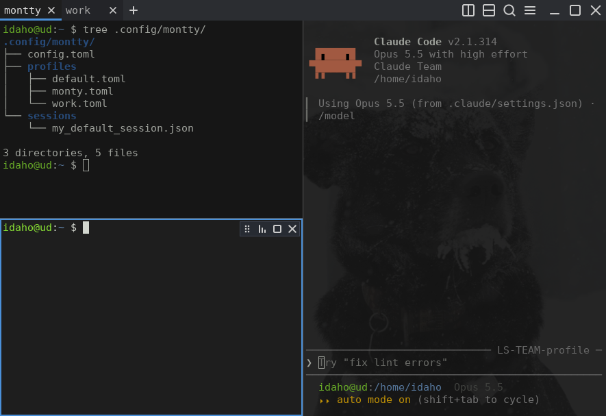

# montty

A tiling terminal emulator for Linux, inspired by [Tilix](https://gnunn1.github.io/tilix-web/) but written in Rust
with no GTK or Qt. It keeps what makes Tilix pleasant (splitting panes, tabs, profiles, saved sessions) and aims to be
small, fast and idle-quiet: it is drawn with OpenGL, runs on X11 and Wayland, and uses no CPU while nothing happens.



## Features

- **Splits:** split right, down, left or up to any depth; drag dividers or use the keyboard to resize; maximize a
  pane; drag a pane's grip onto another pane to swap them.
- **Tabs and windows:** each tab has its own split tree; several windows in one process.
- **Profiles:** named settings (font, colors, cursor, scrollback, shell, opacity, padding). A pane can switch profile
  from its hover overlay, and editing a profile or `config.toml` applies live, without a restart.
- **Color schemes:** Tilix's JSON format, nine schemes built in.
- **Background images:** PNG or JPEG per profile, with fit modes and opacity, plus window transparency.
- **Sessions:** save and reopen a window's tabs, splits, profiles and working directories.
- **Find, links, clipboard:** search the scrollback, Ctrl+click URLs and OSC 8 links, CLIPBOARD and PRIMARY
  selection, bracketed paste, mouse reporting.
- **Tilix key bindings** by default, every action rebindable in `config.toml`.
- Pane size labels while resizing (and on demand with `Ctrl+Alt+S`), a visual bell, color emoji and CJK.

macOS and Windows are not supported yet.

## Install

Download a package from the [latest release](https://github.com/idahomst/montty/releases/latest).

- Debian / Ubuntu: `sudo apt install ./montty_0.2.1_amd64.deb`
- Arch / CachyOS: `sudo pacman -U montty-0.2.1-1-x86_64.pkg.tar.zst`
- Any Linux (x86_64): unpack `montty-0.2.1-x86_64-linux.tar.gz` and copy the files as described in
  [docs/install.md](docs/install.md).

### Build from source

```bash
cargo build --release      # binary: target/release/montty
```

You need a stable Rust toolchain, 1.85 or newer (the crate uses the 2024 edition), and a C compiler for a few build
scripts. X11, Wayland and OpenGL libraries are loaded at run time, so no `-dev` packages are required. At run time
you need OpenGL 3.3 (or GLES 3), `libxkbcommon`, and a monospace font such as DejaVu Sans Mono.
See [docs/install.md](docs/install.md) for installing the result by hand.

## Configuration

Settings live in plain files under `~/.config/montty/`. There is no settings window: edit the files, and montty applies
every change as soon as you save, with no restart. A file with a mistake keeps its last good version and a toast
names the file and line.

```
~/.config/montty/
  config.toml           window-wide settings and key bindings (optional)
  profiles/<name>.toml  one file per profile
  schemes/<name>.json   extra color schemes in Tilix's JSON format (optional)
  sessions/<name>.json  saved sessions
```

The ≡ menu has `Edit config` (opens `config.toml` in `$VISUAL`/`$EDITOR` in a new tab), `Open config folder` and
`Keyboard shortcuts`. The full reference, including every key binding, is in [docs/config.md](docs/config.md).

### Profiles

A profile is how a pane looks and what it runs: font, color scheme, colors, cursor, opacity, padding, scrollback,
shell, background image.

- **First run:** montty writes `profiles/default.toml` with every setting at its default and a comment on each. Change
  what you want and save; all panes using it restyle live.
- **New profile:** `New profile…` in a pane's profile menu (below) asks for a name and copies the pane's profile to
  `profiles/<name>.toml`, or copy a file yourself, e.g. to `profiles/work.toml`. The file name is the profile's id;
  `name = "Work"` is what the menu shows. Every key is optional.

  ```toml
  name = "Work"
  font = "JetBrains Mono"
  font_size = 12
  scheme = "solarized-dark"   # built-in: tango, linux, solarized-dark/-light, monokai, material, orchis, yaru, base16-twilight-dark
  opacity = 0.9
  ```

- **Use it:** hover a pane and click the **Profile** button in its top-right overlay, then pick a profile; only that
  pane changes and its shell keeps running. The same menu has `Edit profile "…"` for the pane's profile. A split starts with the profile of the pane it came from.
- **Default:** new windows and tabs use `default_profile = "work"` from `config.toml`, or `montty --profile work`.

### Sessions

A session is a window's layout: its tabs, splits, each pane's profile and working directory. Shells start fresh when
it opens; scrollback isn't saved.

- **Save:** `Ctrl+Shift+S` (or `Save session…` in the ≡ menu), type a name, Enter. It goes to `sessions/<name>.json`;
  saving under the same name again replaces it.
- **Open:** `Ctrl+Shift+O` (or `Open session ▸` in the ≡ menu) and pick a name. A window that is still untouched (one
  pane, nothing typed) turns into the session; otherwise it opens in a new window. From the command line:
  `montty --session NAME`.
- **Edit or delete:** sessions are readable JSON files; edit one in any editor (for example to set a pane's `command`),
  or delete the file to drop it. The format is described in [docs/config.md](docs/config.md#the-session-file).
- **Pick up where you left off:** with `restore_last_session = true` in `config.toml`, montty keeps your last window's
  layout in `sessions/_last.json` and reopens it at the next start.

Other docs: [docs/design.md](docs/design.md) (how montty is built and why),
[docs/bench.md](docs/bench.md) (performance measurements and the benchmark procedure).

## Ideas under consideration

Not built yet; reactions in GitHub issues help decide.

- **`montty --config-check`:** check the config files on purpose (valid TOML, known settings, montty's own key
  conflicts) and also warn about shortcuts the desktop takes before montty sees them, such as Cinnamon's screen
  recording on `Ctrl+Alt+Shift+R` or moving windows with Alt+click. Linux has no common interface for asking which
  shortcuts the desktop holds, and Wayland offers none at all, so each desktop (Cinnamon, GNOME, KDE, Xfce, ...)
  would need its own reader, and some (tiling compositors) could not be checked.

## Why montty?

Named after Monty, the author's dog. The app icon is his portrait, drawn by the author.

## License

MIT, see [LICENSE](LICENSE). The built-in color schemes in `assets/schemes/` come from Tilix and are under the MPL-2.0
(see `assets/schemes/LICENSE-NOTICE`).
